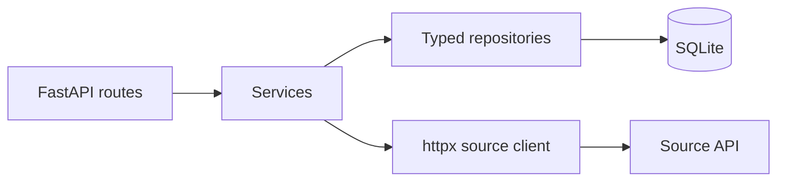
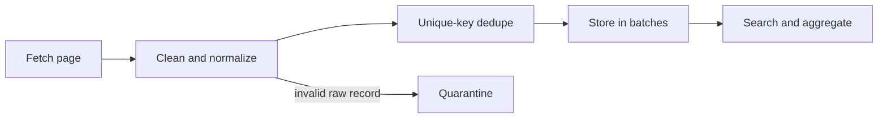

# TickWatch

A small backend MVP for collecting UK tick reports, retaining invalid source rows for review, and serving location, time, species, and trend queries. It supports public health awareness but does not diagnose disease or predict individual risk.

## Quickstart

1. Install Python 3.12 and uv.
2. Run uv sync --extra dev.
3. Start the API with make run and open http://127.0.0.1:8000/docs.
4. Run make test and make lint.
5. Configure TICKWATCH_API_URL if the upstream URL differs, then run make ingest.

## Configuration

| Variable | Default | Purpose |
|---|---|---|
| TICKWATCH_API_URL | https://dev-task.elancoapps.com/ | Source API URL |
| TICKWATCH_DATABASE_PATH | tickwatch.db | SQLite file path |
| TICKWATCH_REQUEST_TIMEOUT | 10 | HTTP timeout seconds |
| TICKWATCH_RETRY_ATTEMPTS | 3 | Bounded transient-error attempts |
| TICKWATCH_ANOMALY_Z_THRESHOLD | 2 | Positive rolling z-score threshold |
| TICKWATCH_CORS_ORIGINS | empty | Comma-separated allowed browser origins |

## Endpoints

- GET /health
- GET /sightings?start_date=2026-01-01&end_date=2026-03-01&region=Kent&species=ixodes%20ricinus&limit=50&offset=0
- GET /sightings/{id}
- GET /analytics/by-region?start_date=2026-01-01&species=ixodes%20ricinus
- GET /analytics/trends?granularity=weekly&region=Kent&species=ixodes%20ricinus
- GET /analytics/by-species
- GET /insights/anomalies?region=Kent
- GET /insights/forecast?region=Kent

All endpoints have executable examples in Swagger at /docs. Query validation errors use a stable error envelope.

## Architecture

## Data and limitations

The upstream host could not be resolved from the implementation environment, so API endpoint behavior, true schema, pagination, data volume, and actual data quality remain unverified. See docs/api-findings.md. The client supports a provisional set of common JSON response shapes. The natural key can collide for indistinguishable reports; an upstream ID is used where present. SQLite is suitable for a local MVP, not concurrent high-volume ingestion. Weekly anomaly scoring needs sufficient history and misses low-count anomalies. The forecast repeats four recent weekly values and is a baseline only. No clinical advice should be inferred.

## Tests and roadmap

Tests use deterministic local fixtures and never contact the upstream. With more time: validate the source contract against live data, add scheduled ingestion, move to Postgres for concurrent scale, cache common aggregates, add auth and rate limits, compare richer forecasting methods, add deployment and monitoring, and extend CI with coverage and security checks.
