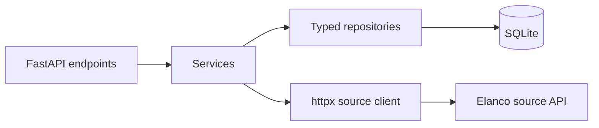
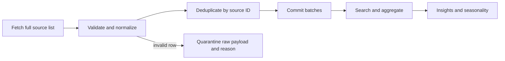

# TickWatch

Author: Hollis

TickWatch ingests tick sightings from the Elanco student API into SQLite and serves searchable counts, trends, anomaly flags, forecasts, and seasonal summaries. It is an educational data project, not medical advice.

## Quickstart

Run these five commands from the repository root:

1. `uv sync --extra dev`
2. `make lint`
3. `make test`
4. `make ingest`
5. `make run`

The API listens on `http://127.0.0.1:8000`. Open `http://127.0.0.1:8000/docs` for interactive documentation. Stop the server with Ctrl+C.

## Configuration

| Variable | Default | Purpose |
|---|---|---|
| `TICKWATCH_API_URL` | `https://dev-task.elancoapps.com/data/tick-sightings` | Source list endpoint |
| `TICKWATCH_DATABASE_PATH` | `tickwatch.db` | SQLite file path |
| `TICKWATCH_PORT` | `8000` | Local development server port |
| `TICKWATCH_REQUEST_TIMEOUT` | `10` | HTTP timeout in seconds |
| `TICKWATCH_RETRY_ATTEMPTS` | `3` | Attempts for transient upstream errors |
| `TICKWATCH_ANOMALY_Z_THRESHOLD` | `2` | Rolling anomaly z-score threshold |
| `TICKWATCH_CORS_ORIGINS` | empty | Comma-separated allowed browser origins |

## Endpoints

The examples below assume the server is running and the database has been ingested.

```bash
curl http://127.0.0.1:8000/health
curl 'http://127.0.0.1:8000/sightings?region=Manchester&limit=25&offset=0'
curl http://127.0.0.1:8000/sightings/02WNholuSg6ndCk4c1dA
curl 'http://127.0.0.1:8000/analytics/by-region?species=Marsh%20tick'
curl http://127.0.0.1:8000/analytics/by-species
curl 'http://127.0.0.1:8000/analytics/trends?granularity=monthly&region=Manchester&species=Marsh%20tick'
curl 'http://127.0.0.1:8000/insights/anomalies?region=Manchester'
curl 'http://127.0.0.1:8000/insights/forecast?region=Manchester'
curl 'http://127.0.0.1:8000/insights/seasonality?city=Manchester&species=Southern%20rodent%20tick'
```

Anomaly and forecast routes default to monthly periods; add `granularity=weekly` to request weekly results. Both require at least nine non-zero periods and return HTTP 422 with `error.code=insufficient_data` below that threshold. Seasonality averages each calendar month over the covered years, weights its chi-square null by month length, and adjusts per-species verdicts with Bonferroni correction. Per-species results include `adjusted_alpha` and `significant_after_adjustment`.

## Architecture





## Verified source and real findings

The real list route is `https://dev-task.elancoapps.com/data/tick-sightings`. It returns 1,000 records in one unpaged array; `limit` and `offset` are ignored. The captured data has five non-null string fields, no duplicate `(date, city, species)` tuples, and a date range from 2012-01-03 through 2024-12-30. Source dates lack timezone offsets and are interpreted as UTC. The source provides city names but no coordinates, so radius searches are not supported.

The overall days-weighted month test found no statistically significant seasonality (`p=0.4314`). Southern rodent tick had an unadjusted `p=0.0176`, but did not pass the five-species Bonferroni threshold (`alpha=0.01`). See [the full monthly profile](docs/monthly-insights-profile.md), [data quality report](docs/data-quality-report.md), and [API discovery notes](docs/api-findings.md).

## Validation tools

- `make demo-quarantine` ingests five malformed examples into a temporary SQLite DB and prints the reason codes with preserved payloads.
- With the API running and data ingested, `uv run python scripts/endpoint_smoke.py --output docs/endpoint-smoke.md` sends a valid and invalid request to each API route.
- `bash scripts/fresh_clone_check.sh` clones the committed repository into a temporary directory and runs the quickstart, ingestion, and endpoint curls.
- `scripts/reconcile_upstream.py` compares local total, city, and species counts to the live service.

## Limitations and next steps

The real API gives no pagination, coordinates, or reporting-effort metadata. The chi-square test assumes independent counts, equal daily reporting opportunity, and an adequate covered span; repeated observations and temporal clustering can overstate significance. The per-species adjustment handles the five current species, but the observed crosswalk can change. Nine non-zero periods are only a minimum data gate, not a guarantee of a reliable forecast or anomaly score. SQLite is suitable for this small MVP, not concurrent high-volume ingestion.

With more time, I would track reporting effort, evaluate seasonality over multiple years with time-series methods, add source-provided pagination or incremental updates, and deploy with monitoring and automated data-quality alerts. I would also revisit the species crosswalk whenever the upstream taxonomy changes.
