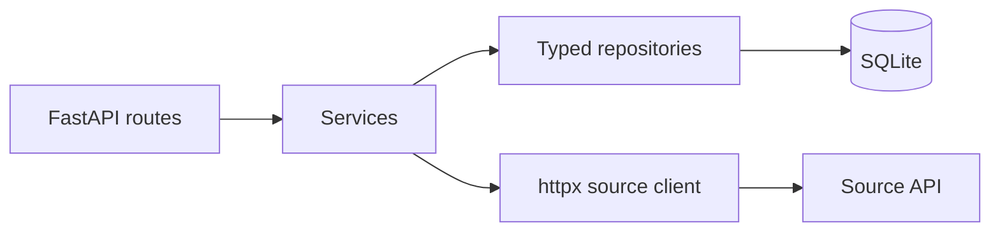
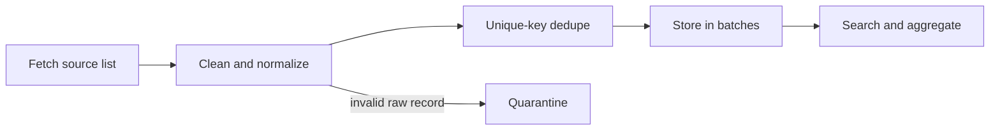

# TickWatch

A small backend MVP for collecting UK tick reports, retaining invalid source rows for review, and serving location, time, species, and trend queries. It supports public health awareness but does not diagnose disease or predict individual risk.

## Quickstart

1. Install Python 3.12 and uv.
2. Run uv sync --extra dev.
3. Start the API with make run and open http://127.0.0.1:8000/docs.
4. Run make test and make lint.
5. Configure TICKWATCH_API_URL if the upstream URL differs, then run make ingest.

## Configuration

| Variable | Default | Purpose |
|---|---|---|
| TICKWATCH_API_URL | https://dev-task.elancoapps.com/data/tick-sightings | Source sightings list URL |
| TICKWATCH_DATABASE_PATH | tickwatch.db | SQLite file path |
| TICKWATCH_REQUEST_TIMEOUT | 10 | HTTP timeout seconds |
| TICKWATCH_RETRY_ATTEMPTS | 3 | Bounded transient-error attempts |
| TICKWATCH_ANOMALY_Z_THRESHOLD | 2 | Positive rolling z-score threshold |
| TICKWATCH_CORS_ORIGINS | empty | Comma-separated allowed browser origins |

## Endpoints

- GET /health
- GET /sightings?start_date=2022-01-01&end_date=2024-12-31&region=Manchester&species=Marsh%20tick&limit=50&offset=0
- GET /sightings/{id}
- GET /analytics/by-region?start_date=2022-01-01&species=Marsh%20tick
- GET /analytics/trends?granularity=weekly&region=Manchester&species=Marsh%20tick
- GET /analytics/by-species
- GET /insights/anomalies?region=Manchester&granularity=monthly
- GET /insights/forecast?region=Manchester&granularity=monthly
- GET /insights/seasonality?city=Manchester&species=Marsh%20tick

All endpoints have executable examples in Swagger at /docs. Query validation errors use a stable error envelope.

## Architecture

## Data and limitations

The live source is `https://dev-task.elancoapps.com/data/tick-sightings`; it returns 1,000 records in one unpaged JSON array. The source has city names but no coordinates, so location queries and analytics use `location` as the normalized `region` and do not offer radius searches. Each observation's source `id` is retained, and `latinName` is stored as `latin_name`. See [docs/api-findings.md](docs/api-findings.md) for verified routes and [docs/monthly-insights-profile.md](docs/monthly-insights-profile.md) for month-of-year counts and sparsity. Anomaly and forecast endpoints use monthly periods by default; pass `granularity=weekly` for weekly periods. They require at least 9 non-zero periods and return HTTP 422 with `error.code=insufficient_data` when the series is too sparse. Seasonality reports average counts by calendar month and a chi-square test against a days-in-month-weighted uniform null. The test assumes independent counts and does not adjust for reporting effort or clustering. SQLite is suitable for a local MVP, not concurrent high-volume ingestion. The forecast is a short naive baseline, not a predictive model. No clinical advice should be inferred.

## Tests and roadmap

Tests use deterministic local fixtures and never contact the upstream. With more time: validate the source contract against live data, add scheduled ingestion, move to Postgres for concurrent scale, cache common aggregates, add auth and rate limits, compare richer forecasting methods, add deployment and monitoring, and extend CI with coverage and security checks.
